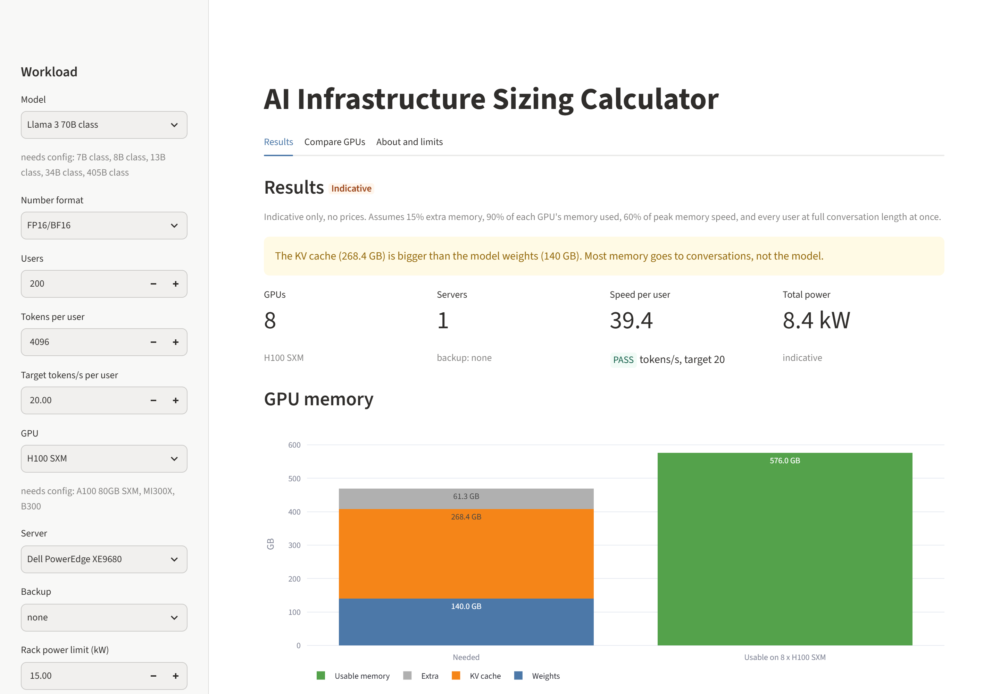
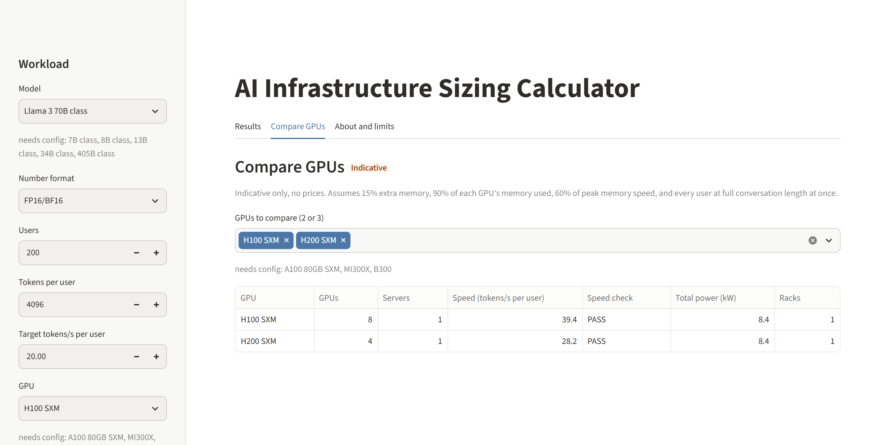
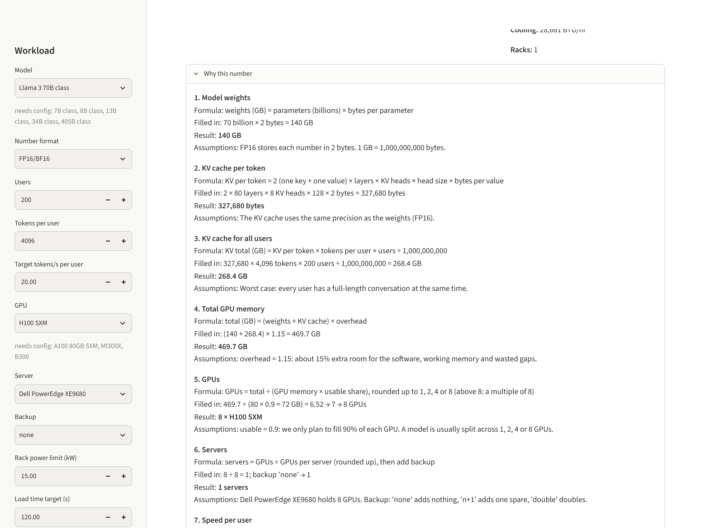

# AI Infrastructure Sizing Calculator

Turns an AI serving workload like "serve a 70B model to 200 users" into GPU memory, GPUs, servers, speed per user, storage, network, power and racks.
Every result is **indicative** and comes with a "Why this number" explanation. There are no prices anywhere.

**Live app:** https://ai-sizing-calculator.streamlit.app

## Screenshots

**Results:** Llama 3 70B class, FP16, 200 users, 4,096 tokens on H100. Summary cards with a PASS/FAIL speed check, and the GPU memory chart (needed vs usable).



**Compare GPUs:** the same workload on H100 and H200, side by side.



**Why this number:** every result explained step by step, with the formula, the real numbers filled in, and the assumptions used.



## How to run (Windows PowerShell)

Run these from the `ai-sizing-calculator` folder:

```powershell
python -m pip install -r requirements.txt
python -m streamlit run app.py
```

Your browser opens at http://localhost:8501. Press `Ctrl+C` in PowerShell to stop the app.
We use `python -m streamlit` instead of plain `streamlit`, because it works even if Python's Scripts folder is not on your PATH.

**What you see**

- **Sidebar:** model, number format, users, tokens per user, target speed, GPU, server, backup, rack power limit and load time. Models and GPUs with `null` specs can't be picked and are listed under "needs config". "Custom" lets you type in your own model.
- **Advanced assumptions:** sliders for extra memory, usable memory, speed efficiency and server power factor. They start at the values in `sizing/defaults.py`.
- **Results tab:** four cards (GPUs, servers, speed with PASS/FAIL, total power), the GPU memory chart, the Storage, Network and Power sections, warnings, "Why this number", and "Download PDF summary".
- **Compare GPUs tab:** the same workload on 2 or 3 GPUs in one table.
- **About and limits tab:** what the tool does, the assumptions in use, and what it does not do.

## How to run the tests

```powershell
python -m pytest
```

To run one file only, for example the worked example:

```powershell
python -m pytest tests/test_worked_example.py
```

`tests/test_app.py` starts the real app without a browser and checks the screen, so you don't need to open it yourself.

## The formulas in simple words

All sizes use **decimal GB**: 1 GB = 1,000,000,000 bytes. The default numbers (15% extra, 90% usable and so on) live in one place: `sizing/defaults.py`.

**Memory**

1. **Bytes per number:** FP16/BF16 = 2, FP8/INT8 = 1, INT4 = 0.5.
2. **Weights:** the model must sit in GPU memory. `weights_gb = billions of parameters × bytes per number`.
3. **KV cache per token:** for every token in a conversation, each layer keeps a key and a value (that is the 2). `2 × layers × KV heads × head size × bytes`.
4. **KV cache for everyone:** worst case, every user is at full length at once. `KV per token × tokens per user × users ÷ 1e9`.
5. **Total:** `(weights + KV cache) × 1.15` for software, working memory and gaps.

**GPUs and servers**

6. **GPUs:** only 90% of each GPU is planned for. `ceil(total ÷ (GPU memory × 0.9))`, then rounded up to 1, 2, 4 or 8 (above 8, to a multiple of 8).
7. **Servers:** `ceil(GPUs ÷ GPUs per server)`. Backup: `none` keeps it, `n+1` adds one, `double` doubles it.

**Speed**

8. To write each new token, the GPUs read all the weights plus every user's KV cache. `time per token = (weights + KV) ÷ (GPUs × memory speed × 0.6)`, and `speed per user = 1 ÷ time per token`. It passes if this is at least the target (20 tokens/s).

**Storage and network**

9. **Disk:** `weights × 3 versions × 1.2` for logs.
10. **Read speed:** each server loads its own copy in 120 s. `weights × servers ÷ 120`.
11. **User traffic:** `users × tokens/s × 10 bytes × 8 ÷ 1,000,000` Mb/s.
12. **Network advice (rule of thumb):** 1 server → 2 × 25 or 100 GbE. Several servers → 100 GbE front end plus a storage network. Model split across servers → 400 Gb/s class links (InfiniBand or RDMA Ethernet).

**Power**

13. **Per server:** all GPU slots counted as full. `GPUs per server × GPU watts × 1.5 ÷ 1000` kW.
14. **Total:** `servers × per-server kW`. **Cooling:** `total kW × 3412` BTU/hr.
15. **Racks:** `ceil(servers ÷ max(1, floor(15 kW ÷ per-server kW)))`.

## Worked example

Llama 3 70B class, FP16, 4,096 tokens per user, 200 users, H100 80 GB, target 20 tokens/s:

| Step | Backup "none" | Backup "n+1" |
|---|---|---|
| Weights | 70 × 2 = **140 GB** | same |
| KV per token | 2 × 80 × 8 × 128 × 2 = **327,680 bytes** | same |
| KV total | 327,680 × 4,096 × 200 ÷ 1e9 ≈ **268.4 GB** | same |
| Total with 15% extra | (140 + 268.4) × 1.15 ≈ **469.7 GB** | same |
| GPUs | 469.7 ÷ 72 ≈ 6.5 → 7 → **8** | same |
| Servers | **1** | **2** |
| Time per token | 408.4 ÷ (8 × 3,350 × 0.6) ≈ **0.0254 s** | same |
| Speed per user | ≈ **39.4 tokens/s (PASS)** | same |
| Disk | 140 × 3 × 1.2 = **504 GB** | same |
| Storage read | 140 × 1 ÷ 120 ≈ **1.17 GB/s** | 140 × 2 ÷ 120 ≈ **2.33 GB/s** |
| User traffic | ≈ **0.63 Mb/s** | same |
| Network | 2 × 25 or 100 GbE | 100 GbE front end plus a storage network |
| Power | **8.4 kW** | **16.8 kW** |
| Cooling | ≈ **28,661 BTU/hr** | ≈ **57,322 BTU/hr** |
| Racks (15 kW) | **1** | **2** |

On H200 (141 GB) the same workload needs **4 GPUs** and reaches about **28.2 tokens/s** per user.

## Data files and how to fill a TODO safely

| File | What it holds |
|---|---|
| `data/gpus.yaml` | GPU memory (GB), memory speed (GB/s), power (W) |
| `data/servers.yaml` | GPUs per server, height (U), cooling |
| `data/models.yaml` | Model presets: parameters, layers, KV heads, head size |

Every row has a `source` link and a `checked_on` date. A value of `null` means "not known yet". The app hides rows with `null` specs and lists them under "needs config".

**To fill a TODO:**

1. Find the number on the **official** spec sheet (the vendor's page, or the model's own `config.json`). Never guess.
2. Replace `null` with the number. Use the same unit as the field name says (`_gb`, `_gb_s`, `_w`).
3. Set `source` to the link you used and `checked_on` to today's date, for example `2026-11-08`.
4. Remove the `# TODO` comment from that line only.
5. Run `python -m pytest`. It should stay green.
6. Start the app. The row should now appear in the dropdown, and its name should be gone from "needs config".

For model presets the config file names are usually `num_hidden_layers` (layers), `num_key_value_heads` (KV heads), and `head_dim`, or `hidden_size ÷ num_attention_heads` (head size).

## Limits

- **Indicative only: confirm every design with the vendor's sizing tools.**
- No prices or costs.
- Serving (inference) only. No training sizing.
- No real benchmarks. Speed comes from a memory-speed formula, not measured runs.
- The prompt-reading phase (prefill) is ignored in the speed check. Only answer writing is counted.
- Worst case everywhere: every user at full conversation length at once, every GPU slot full, backup servers switched on.
- Network advice is a rule of thumb, not a network design.

## How to deploy on Streamlit Community Cloud

Streamlit Community Cloud runs the app from a GitHub repository, for free.

1. **Put the project on GitHub.** In PowerShell, from the `ai-sizing-calculator` folder:
   ```powershell
   git init
   git add .
   git commit -m "AI Infrastructure Sizing Calculator"
   gh repo create ai-sizing-calculator --public --source . --push
   ```
   If you don't use the `gh` tool, create an empty repository on github.com, then follow the "push an existing repository" commands it shows you.
2. **Sign in** at https://share.streamlit.io with your GitHub account. Allow Streamlit to read your repositories when it asks.
3. Click **Create app**, then **Deploy a public app from GitHub**.
4. Fill in:
   - **Repository:** `<your-github-name>/ai-sizing-calculator`
   - **Branch:** `main`
   - **Main file path:** `app.py`
   - **App URL:** pick a short name, for example `ai-sizing-calculator`
5. Open **Advanced settings** and choose **Python 3.11** or newer, because pandas 3 needs it. No secrets are needed.
6. Click **Deploy**. The first start takes a few minutes while the packages install.
7. **To update the live app**, commit and push to `main`. Streamlit redeploys on its own.

If the deploy fails, open **Manage app** (bottom right of the app page) to read the logs. The most common cause is a missing package in `requirements.txt`.

## Project layout

| Path | What it holds |
|---|---|
| `app.py` | The Streamlit screen. It only collects inputs, calls the engine, and shows results. |
| `sizing/` | The engine: `models.py` (loads YAML), `memory.py`, `cluster.py`, `throughput.py`, `storage_network.py`, `power.py`, `defaults.py`, `engine.py` (`size_workload()`), `explain.py` |
| `ui/` | Screen helpers you can test without Streamlit: `forms.py`, `checks.py`, `display.py`, `charts.py`, `compare.py`, `about.py` |
| `exports/pdf_summary.py` | The one-page PDF summary (plain ASCII, returned as bytes) |
| `data/` | The YAML data files |
| `tests/` | All tests, including the worked example and app smoke tests |
| `.streamlit/config.toml` | Theme settings |

## What I would add in v2

- **Cost:** hardware, power and cloud-rental estimates, clearly dated and sourced.
- **Training sizing:** GPUs and time to fine-tune or train a model.
- **RAG sizing:** vector database size, embedding throughput, and the extra prompt tokens that retrieval adds.
- **Prefill in the speed check:** time to first token for long prompts.
- **Measured benchmarks:** replace the speed formula with real numbers where they exist.
